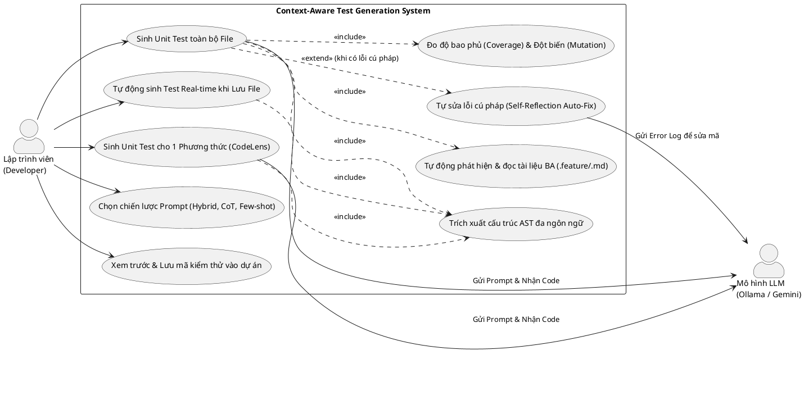
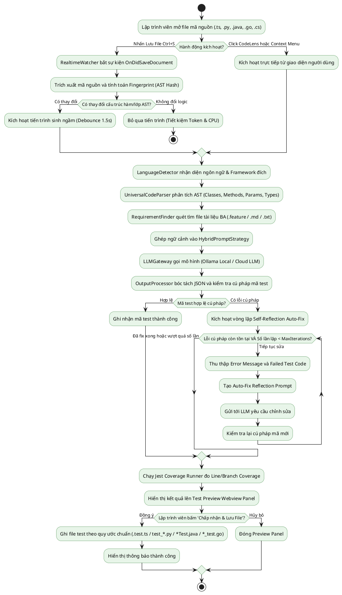
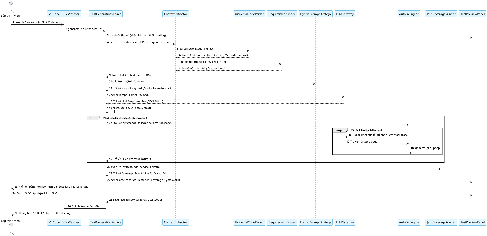

# BÁO CÁO NGHIÊN CỨU & PHÁT TRIỂN HỆ THỐNG
# TỰ ĐỘNG SINH UNIT TEST DỰA TRÊN NGỮ CẢNH NGHIỆP VỤ VÀ MÃ NGUỒN (CONTEXT-AWARE UNIT TEST GENERATOR)

---

## MỤC LỤC
1. [BỐI CẢNH ĐỀ TÀI (CONTEXT)](#1-bối-cảnh-đề-tài-context)
2. [LÝ DO CHỌN ĐỀ TÀI & VẤN ĐỀ NGHIÊN CỨU (MOTIVATION & PROBLEM STATEMENT)](#2-lý-do-chọn-đề-tài--vấn-đề-nghiên-cứu-motivation--problem-statement)
3. [CÁC KHÁI NIỆM CỐT LÕI (CORE CONCEPTS)](#3-các-khái-niệm-cốt-lõi-core-concepts)
4. [CÔNG NGHỆ & CÔNG CỤ SỬ DỤNG (TECH STACK)](#4-công-nghệ--công-cụ-sử-dụng-tech-stack)
5. [KIẾN TRÚC HỆ THỐNG & LUỒNG XỬ LÝ (ARCHITECTURE & CODE FLOW)](#5-kiến-trúc-hệ-thống--luồng-xử-lý-architecture--code-flow)
6. [HỆ THỐNG SƠ ĐỒ THIẾT KẾ (PLANTUML DIAGRAMS)](#6-hệ-thống-sơ-đồ-thiết-kế-plantuml-diagrams)
   - [6.1. Sơ đồ Kiến trúc Tổng thể (Architecture Diagram)](#61-sơ-đồ-kiến-trúc-tổng-thể-architecture-diagram)
   - [6.2. Sơ đồ Trường hợp Sử dụng (Use Case Diagram)](#62-sơ-đồ-trường-hợp-sử-dụng-use-case-diagram)
   - [6.3. Sơ đồ Hoạt động: Luồng sinh Test Real-time & Auto-Fix (Activity Diagram)](#63-sơ-đồ-hoạt-động-luồng-sinh-test-real-time--auto-fix-activity-diagram)
   - [6.4. Sơ đồ Tuần tự Chi tiết (Sequence Diagram)](#64-sơ-đồ-tuần-tự-chi-tiết-sequence-diagram)
7. [KẾT QUẢ TRIỂN KHAI & THỰC NGHIỆM (RESULTS & BENCHMARK)](#7-kết-quả-triển-khai--thực-nghiệm-results--benchmark)
8. [NGHIÊN CỨU LIÊN QUAN (RELATED WORK)](#8-nghiên-cứu-liên-quan-related-work)
9. [HƯỚNG PHÁT TRIỂN & KẾT LUẬN (FUTURE WORK & CONCLUSION)](#9-hướng-phát-triển--kết-luận-future-work--conclusion)

---

## 1. BỐI CẢNH ĐỀ TÀI (CONTEXT)

Trong quy trình phát triển phần mềm hiện đại (Agile/DevOps), **Kiểm thử đơn vị (Unit Testing)** đóng vai trò là "chốt chặn chất lượng" đầu tiên giúp phát hiện sớm các lỗi logic, giảm thiểu chi phí sửa lỗi (Bug Cost) ở các giai đoạn sau và bảo vệ hệ thống khi tái cấu trúc mã nguồn (Refactoring).

Tuy nhiên, trong thực tế phát triển phần mềm:
- Việc viết Unit Test thường bị xem nhẹ hoặc bỏ qua do áp lực tiến độ (Deadline).
- Các công cụ sinh Unit Test truyền thống (như EvoSuite, Randoop dựa trên thuật toán di truyền hoặc ngẫu nhiên) chỉ tập trung vào việc đạt độ phủ mã nguồn (**Code Coverage**) bằng các giá trị ngẫu nhiên vô nghĩa, thiếu đi sự hiểu biết về **ý đồ nghiệp vụ (Business Intent)**.
- Khi các mô hình ngôn ngữ lớn (LLM - Large Language Models) như GPT-4, Claude, Gemini, DeepSeek xuất hiện, tiềm năng tự động hóa kiểm thử đã tăng vọt. Dẫu vậy, nếu chỉ đưa mã nguồn đơn thuần cho LLM mà không có ngữ cảnh tài liệu nghiệp vụ (BA Requirements / User Stories / Gherkin Specs), LLM sẽ sinh ra các test case "ảo tưởng" (Hallucination), hoặc chỉ lặp lại logic sai sót có sẵn trong code (Code Bias).

Chính vì vậy, đề tài **"Context-Aware Unit Test Generation"** ra đời nhằm kết hợp chặt chẽ giữa **Phân tích cú pháp trừu tượng mã nguồn (AST Analysis)**, **Tài liệu nghiệp vụ (Business Requirements)** và **Kỹ nghệ Prompt đa tầng (Prompt Engineering + Self-Reflection Auto-Fix)** vào một **VS Code Extension** hoạt động thời gian thực (Real-time).

---

## 2. LÝ DO CHỌN ĐỀ TÀI & VẤN ĐỀ NGHIÊN CỨU (MOTIVATION & PROBLEM STATEMENT)

### 2.1. Vấn đề thực tế (Problem Statement)
1. **Khoảng cách giữa Nghiệp vụ (BA) và Mã nguồn (Dev):** 
   Lập trình viên thường bỏ sót các ca biên (Edge Cases), điều kiện ngoại lệ (Exceptions) mà Business Analyst (BA) đã định nghĩa trong tài liệu đặc tả (User Stories, Acceptance Criteria).
2. **Ảo tưởng của LLM & Mã Test lỗi cú pháp:**
   Mã kiểm thử do AI sinh ra thường xuyên gặp lỗi cú pháp (Syntax Errors), sai lệch tên hàm hoặc kiểu dữ liệu giả định, khiến lập trình viên mất thêm thời gian sửa lỗi thủ công.
3. **Độ trễ và Tính rời rạc:**
   Các công cụ hiện nay yêu cầu lập trình viên copy/paste code sang trình duyệt (ChatGPT/Claude) rồi paste ngược lại IDE, làm gián đoạn luồng làm việc (Context Switching).
4. **Hạn chế đơn ngôn ngữ:**
   Đa số giải pháp chỉ tập trung vào một ngôn ngữ cố định (TypeScript hoặc Python), trong khi môi trường thực tế yêu cầu hỗ trợ đa ngôn ngữ (Polyglot: Java, Go, C#, Python, TS/JS).

### 2.2. Mục tiêu nghiên cứu (Objectives)
- **Tự động liên kết ngữ cảnh:** Tự động phát hiện và trích xuất đồng thời mã nguồn (hàm, lớp, tham số) và tài liệu nghiệp vụ (file `.feature`, `.md`, `spec.txt`).
- **Chiến lược sinh kiểm thử đa tầng (Prompt Strategies):** Hiện thực hóa 4 chiến lược: *Zero-shot*, *Few-shot*, *Chain-of-Thought (CoT)* và *Hybrid Strategy* để đánh giá đối sánh.
- **Cơ chế Tự sửa lỗi (Self-Reflection Auto-Fix):** Tự động bắt lỗi cú pháp, đưa phản hồi lỗi (Compiler Error Feedback) ngược lại cho LLM để sửa mã test tự động trong tối đa $N$ vòng lặp.
- **Tích hợp Real-time & CodeLens trong IDE:** Tích hợp trực tiếp vào VS Code Extension, sinh test tức thì khi lưu file (`onSave` với AST Diff) hoặc click nút CodeLens trên từng hàm.
- **Khả năng mở rộng đa ngôn ngữ (Polyglot Readiness):** Thiết lập hệ thống kiểm định và benchmark chuẩn hóa trên TypeScript/Jest; đồng thời xây dựng kiến trúc phân tích cú pháp mở rộng (Universal AST Parser prototype) hỗ trợ nhận diện cấu trúc cho Python, Java, C#, Go (kèm PoC demo tại `examples/go_demo/`).

---

## 3. CÁC KHÁI NIỆM CỐT LÕI (CORE CONCEPTS)

Để người đọc dễ dàng nắm bắt, dưới đây là các khái niệm chuyên ngành nền tảng được định nghĩa trực quan:

| Khái niệm | Định nghĩa chi tiết | Vai trò trong hệ thống |
| :--- | :--- | :--- |
| **Unit Test (Kiểm thử đơn vị)** | Đoạn mã dùng để kiểm tra tính đúng đắn của một đơn vị mã nguồn nhỏ nhất (hàm, phương thức, lớp) một cách cô lập. | Đầu ra chính của hệ thống. |
| **AST (Abstract Syntax Tree)** | Cây cú pháp trừu tượng thể hiện cấu trúc ngữ pháp phân cấp của mã nguồn (Class, Method, Parameter, Return Type). | Giúp hệ thống "hiểu" mã nguồn mà không cần thực thi code. |
| **Gherkin / Acceptance Criteria** | Ngôn ngữ tự nhiên có cấu trúc (`Given - When - Then`) dùng để mô tả tiêu chuẩn chấp nhận nghiệp vụ của tính năng. | Nguồn ngữ cảnh BA giúp LLM sinh test case đúng nghiệp vụ. |
| **Chain-of-Thought (CoT)** | Kỹ thuật chia nhỏ quá trình suy luận của LLM thành các bước logic tuần tự trước khi đưa ra câu trả lời cuối cùng. | Giúp LLM lập luận ma trận đối chiếu giữa Rule BA và Code. |
| **Self-Reflection Auto-Fix** | Cơ chế phản hồi khép kín: khi mã test sinh ra bị lỗi biên dịch hoặc assertion, hệ thống gửi thông báo lỗi lại cho LLM để tự sửa và kiểm chứng bằng test runner. | Tự động phục hồi mã test bị lỗi cú pháp/logic qua vòng lặp phản hồi. |
| **Mutation Testing (Kiểm thử đột biến)** | Phương pháp đánh giá chất lượng bộ test bằng cách cố tình tạo ra các lỗi nhỏ (Mutants) trong code. Nếu bộ test phát hiện và làm fail test $\rightarrow$ mutant bị "tiêu diệt" (Killed). | Thước đo vàng đánh giá khả năng phát hiện lỗi của bộ test. |
| **Code Coverage** | Tỷ lệ phần trăm dòng lệnh (Line Coverage) hoặc nhánh rẽ (Branch Coverage) được thực thi bởi bộ kiểm thử. | Thước đo độ bao phủ luồng logic mã nguồn. |

---

## 4. CÔNG NGHỆ & CÔNG CỤ SỬ DỤNG (TECH STACK)

```
+-------------------------------------------------------------------------+
|                              TECH STACK                                 |
+-------------------------------------------------------------------------+
| Frontend / IDE     : VS Code Extension API, Webview Panel (HTML5/CSS3)  |
| Core Engine        : TypeScript 5.x, Node.js v20+                       |
| AST Parsing        : Babel Parser, TypeScript Compiler API, Regex Parser|
| LLM Gateway        : Ollama (Local), Google Gemini, DeepSeek, OpenAI    |
| Testing Frameworks : Jest (Hệ thống đánh giá chính), Prototype: pytest, JUnit 5, Go test|
| Quality Evaluation : Custom MutationRunner (Mutation Score), Jest Coverage|
| Build & Bundling   : NPM Workspaces, TypeScript Compiler (`tsc`)        |
+-------------------------------------------------------------------------+
```

1. **Ngôn ngữ phát triển:** TypeScript (đảm bảo Type Safety trên cả kiến trúc Monorepo).
2. **VS Code Extension API:** Đăng ký CodeLens Provider, Webview Provider, Document Watcher, Context Menu.
3. **Cổng giao tiếp LLM (LLM Gateway):**
   - **Ollama (Mặc định local):** Hỗ trợ mô hình mã nguồn mở như `qwen2.5-coder:1.5b`, `llama3.2`, `codellama` đảm bảo tính bảo mật và riêng tư mã nguồn cho doanh nghiệp.
   - **Cloud Providers:** Google Gemini (`gemini-2.0-flash`), OpenAI (`gpt-4o`), DeepSeek API.
4. **Công cụ đánh giá (Evaluation Harness):**
   - **MutationRunner Engine (AST Mutators):** Bộ đột biến mã nguồn dựa trên AST (Toán tử so sánh, điều kiện biên, logic, số học) và chạy Jest kiểm thử để đo Mutation Score thực nghiệm thực tế.
   - **Jest Runner API:** Đo đạc Line Coverage & Branch Coverage tự động.

### 4.1. Ma trận Hỗ trợ Ngôn ngữ & Phân định Phạm vi (Language Support Matrix)

Để đảm bảo tính khoa học và minh bạch giữa các tính năng đã kiểm chứng hoàn chỉnh và các module prototype:

| Ngôn ngữ / Hệ sinh thái | Phân tích AST | Sinh Prompt theo BA | Kiểm tra cú pháp (Syntax Validation) | Test Runner & Coverage | Benchmark Dataset | Trạng thái Hiện thực & Kiểm chứng |
|---|:---:|:---:|:---:|:---:|:---:|:---:|
| **TypeScript / JavaScript** | ✅ Đầy đủ (TS API & Babel) | ✅ Đầy đủ (4 Strategies) | ✅ TS Compiler API | ✅ Jest Runner tự động | ✅ 15 Services (133 tests) | **Triển khai & Kiểm chứng Toàn diện (End-to-End)** |
| **Python** | ✅ Universal AST Parser | ✅ Hỗ trợ Prompt | ⚠️ Cơ bản | ⏳ Dự kiến pytest | ⏳ Future Work | **Prototype phân tích cú pháp (Parser Prototype)** |
| **Java** | ✅ Universal AST Parser | ✅ Hỗ trợ Prompt | ⚠️ Cơ bản | ⏳ Dự kiến JUnit 5 | ⏳ Future Work | **Prototype phân tích cú pháp (Parser Prototype)** |
| **Go** | ✅ Universal AST Parser | ✅ Hỗ trợ Prompt | ⚠️ Cơ bản | ⏳ Dự kiến `go test` | ⏳ Demo PoC (`examples/go_demo/`) | **Prototype phân tích cú pháp & PoC Demo** |
| **C#** | ✅ Universal AST Parser | ✅ Hỗ trợ Prompt | ⚠️ Cơ bản | ⏳ Dự kiến xUnit/NUnit | ⏳ Future Work | **Prototype phân tích cú pháp (Parser Prototype)** |

---

## 5. KIẾN TRÚC HỆ THỐNG & LUỒNG XỬ LÝ (ARCHITECTURE & CODE FLOW)

Hệ thống được thiết kế theo cấu trúc Monorepo module hóa cao độ:

```
context-aware-unit-test-generation/
├── packages/
│   ├── core/                        # Engine xử lý cốt lõi độc lập với IDE
│   │   ├── src/
│   │   │   ├── extractor/           # Trích xuất AST & Ngữ cảnh BA
│   │   │   │   ├── ast_parser.ts            # Parser TypeScript AST (Babel)
│   │   │   │   ├── universal_ast_parser.ts  # Parser đa ngôn ngữ (Python, Java, Go, C#)
│   │   │   │   ├── language_detector.ts     # Nhận diện ngôn ngữ & Framework test
│   │   │   │   └── context_extractor.ts     # Bộ gom dữ liệu ngữ cảnh Code + BA
│   │   │   ├── prompts/             # 4 Chiến lược Prompt Engineering
│   │   │   │   ├── zero_shot.ts, few_shot.ts, cot.ts, hybrid.ts
│   │   │   ├── llm/                 # Cổng kết nối LLM (Ollama, Gemini, DeepSeek)
│   │   │   ├── pipeline/            # Pipeline xử lý đầu cuối (Generator Pipeline)
│   │   │   └── evaluator/           # Đo lường Coverage & Mutation Testing
│   │
│   └── extension/                   # VS Code Extension tương tác người dùng
│       ├── src/
│       │   ├── codelens/            # Hiển thị nút bấm Inline trên hàm/lớp
│       │   ├── services/            # Watcher Realtime, Auto-Fix Engine, Test Service
│       │   ├── webview/             # Bảng điều khiển giao diện Preview trực quan
│       │   └── sidebar/             # Thanh công cụ bên hông VS Code
```

### Chi tiết luồng xử lý (Step-by-step Flow):
1. **Bước 1 (Lắng nghe sự kiện):** Lập trình viên lưu file (`Ctrl + S`) hoặc bấm nút CodeLens `[⚡ Sinh test BA]`.
2. **Bước 2 (AST & BA Extraction):** `LanguageDetector` xác định ngôn ngữ nguồn; `UniversalCodeParser` bóc tách cây AST (tên lớp, danh sách hàm, kiểu dữ liệu); `RequirementFinder` tự động quét thư mục tìm file BA tương ứng (`.feature`, `.md`).
3. **Bước 3 (Prompt Formatting):** Ghép ngữ cảnh vào chiến lược được chọn (`HybridPromptStrategy`), tạo Prompt giàu ngữ cảnh với cấu trúc đầu ra JSON nghiêm ngặt.
4. **Bước 4 (LLM Inference):** Gửi payload tới LLM (Ollama Local hoặc Gemini Cloud) qua `LLMGateway`.
5. **Bước 5 (Output Processing & Syntax Check):** Phân giải JSON, trích xuất mã test và danh sách Test Scenarios, kiểm tra cú pháp mã sinh ra.
6. **Bước 6 (Self-Reflection Auto-Fix - nếu có lỗi):** Nếu phát hiện lỗi cú pháp, tự động kích hoạt `AutoFixEngine` gửi lỗi biên dịch lại cho LLM để chỉnh sửa tức thì.
7. **Bước 7 (Preview & Execution):** Cập nhật kết quả lên Webview Preview Panel, chạy Jest Coverage ngầm và hiển thị phần trăm độ bao phủ cho lập trình viên.

---

## 6. HỆ THỐNG SƠ ĐỒ THIẾT KẾ (PLANTUML DIAGRAMS)

### 6.1. Sơ đồ Kiến trúc Tổng thể (Architecture Diagram)

```plantuml
@startuml
skinparam componentStyle uml2
skinparam backgroundColor #FFFFFF
skinparam packageBackgroundColor #F8F9FA
skinparam componentBackgroundColor #E3F2FD
skinparam componentBorderColor #1565C0

package "VS Code Extension Layer" {
  [RealtimeDocumentWatcher] as Watcher
  [ContextAwareCodeLensProvider] as CodeLens
  [TestPreviewPanel] as Preview
  [AutoFixEngine] as AutoFix
  [ConfigurationManager] as Config
}

package "Core Engine Layer" {
  package "Context Extraction" {
    [LanguageDetector] as LangDetect
    [UniversalCodeParser] as ASTParser
    [RequirementFinder] as BAFinder
    [ContextExtractor] as Extractor
  }

  package "Prompt Engineering" {
    [ZeroShotStrategy] as ZS
    [FewShotStrategy] as FS
    [ChainOfThoughtStrategy] as CoT
    [HybridPromptStrategy] as Hybrid
  }

  package "Execution & Evaluation" {
    [CoreGeneratorPipeline] as Pipeline
    [OutputProcessor] as Processor
    [CoverageRunner] as Coverage
    [MutationTester] as Mutation
  }

  package "LLM Layer" {
    [LLMGateway] as Gateway
    [OllamaClient (Local)] as Ollama
    [GeminiClient (Cloud)] as Gemini
    [DeepSeekClient (Cloud)] as DeepSeek
  }
}

Watcher --> Extractor : Triggers on Save
CodeLens --> Pipeline : Triggers on Click
Pipeline --> LangDetect : Detects Language
Pipeline --> ASTParser : Parses AST Structure
Pipeline --> BAFinder : Finds .feature/.md
Pipeline --> Hybrid : Builds Enriched Prompt
Hybrid --> Gateway : Sends Prompt Payload
Gateway --> Ollama : Local Inference (Qwen2.5)
Gateway --> Gemini : Cloud Inference
Gateway --> DeepSeek : Cloud Inference
Pipeline --> Processor : Validates JSON & Syntax
Processor --> AutoFix : Triggers reflection on error
AutoFix --> Gateway : Fixes syntax loop
Pipeline --> Coverage : Measures Branch/Line Coverage
Pipeline --> Preview : Renders UI & Test Code
@enduml
```



---

### 6.2. Sơ đồ Trường hợp Sử dụng (Use Case Diagram)



---

### 6.3. Sơ đồ Hoạt động: Luồng sinh Test Real-time & Auto-Fix (Activity Diagram)



---

### 6.4. Sơ đồ Tuần tự Chi tiết (Sequence Diagram)



---

## 7. KẾT QUẢ TRIỂN KHAI & THỰC NGHIỆM (RESULTS & BENCHMARK)

### 7.1. Tập dữ liệu thực nghiệm (Dataset Catalog)
Bộ benchmark gồm **15 bài toán mẫu TypeScript** chuẩn hóa, phân cấp thành 3 mức độ (Simple, Medium, Complex), đi kèm đầy đủ mã nguồn Service (`service.ts`), tài liệu đặc tả nghiệp vụ (`requirement.md`) và bộ kiểm thử chuẩn (`ground_truth.test.ts`):
- **Simple (S01 - S05):** `s01_discount_calculator`, `s02_password_validator`, `s03_shipping_fee_calculator`, `s04_tax_calculator`, `s05_slug_generator`.
- **Medium (S06 - S10):** `s06_auth_service`, `s07_cart_service`, `s08_coupon_service`, `s09_notification_service`, `s10_user_profile_service`.
- **Complex (S11 - S15):** `s11_payment_service`, `s12_order_fulfillment_service`, `s13_booking_concurrency_service`, `s14_subscription_renewal_service`, `s15_loyalty_point_service`.

*Phân chia tập dữ liệu (Dataset Partitioning):*
- **Train (9 service records, 89 test scenarios):** S01, S02, S03, S06, S07, S08, S11, S12, S13 (trích xuất 89 kịch bản kiểm thử có đối chiếu AC/BR xác thực).
- **Validation (3 service records, 17 test scenarios):** S04, S09, S14 (phục vụ checkpoint tuning và thẩm định siêu tham số).
- **Test Holdout (3 service records, 27 test scenarios):** S05, S10, S15 (tập kiểm thử độc lập, hoàn toàn cách ly 0% data leakage).
- **Tổng toàn bộ benchmark:** 15 service records với 133 test scenarios chuẩn hóa.

*Ghi chú phạm vi (Scope & Limitations):* Benchmark hiện tại là bộ **pilot benchmark gồm 15 dịch vụ trên hệ sinh thái TypeScript / Jest**. Toàn bộ pipeline đo đạc tự động (Code Coverage, Mutation Testing, Dataset Validator) được chạy hoàn chỉnh trên TypeScript/Jest. Các module mở rộng (Python parser, Go demo tại `examples/go_demo/`) là các prototype kiến trúc chứng minh tính khả thi mở rộng, không dùng để công bố số liệu kiểm thử đầu-cuối trong báo cáo này.

### 7.2. Kết quả Đo lường Ground Truth & Mục tiêu Đánh giá Đối sánh

#### Bảng 1: Kiểm định tính đúng đắn của Bộ Ground Truth (Verified Baseline Artifact)
*Toàn bộ 15 bộ test chuẩn đã được chạy kiểm thử thật qua Jest runner trong Docker container, lưu trữ tại `experiments/results/ground_truth_eval_summary.json` (lệnh chạy: `npm run dataset:validate`):*

| Độ phức tạp | Số lượng Service | Tổng Test Cases | Tỷ lệ Pass Suite | Line Coverage trung bình | Branch Coverage trung bình |
| :--- | :---: | :---: | :---: | :---: | :---: |
| **Simple (S01 - S05)** | 5 | 46 | 100% (5/5) | **99.31%** | **98.67%** |
| **Medium (S06 - S10)** | 5 | 40 | 100% (5/5) | **94.96%** | **86.59%** |
| **Complex (S11 - S15)** | 5 | 47 | 100% (5/5) | **100.0%** | **90.03%** |
| **Toàn bộ Benchmark (Pilot)** | **15** | **133** | **100% (15/15)** | **98.09%** | **91.76%** |

*Truy vết thực nghiệm:* Dữ liệu đo đạc được tổng hợp từ 15 tệp kiểm thử chuẩn thực tế; 133/133 test assertions đều pass; không có giá trị giả định.

#### Bảng 2: Ma trận Đối sánh Thiết kế Prompt Strategy (Code-Aligned Specification)
*(Được hiện thực hóa trong `packages/core/src/prompts/` và đánh giá qua `experiments/batch_runner.ts` & `experiments/evaluate_generated_tests.ts`)*

| Chiến lược Prompt | Context Đầu vào | Exemplar & Hướng dẫn | Định dạng Đầu ra | Vai trò trong Nghiên cứu |
| :--- | :--- | :--- | :--- | :--- |
| **1. Zero-Shot** | Source Code (+ AST; + BA Doc nếu ablation=full) | Không có exemplar, không hướng dẫn reasoning | `CODE_BLOCK` (`typescript`) | Baseline đối chứng trực tiếp |
| **2. Few-Shot** | Source Code (+ AST; + BA Doc nếu ablation=full) | **Exemplar cố định** (S01 Discount Calculator trong code, *không phải mẫu động từ Train*) | `CODE_BLOCK` (`typescript`) | Baseline học mẫu cú pháp và assertion |
| **3. Chain-of-Thought (CoT)** | Source Code (+ AST; + BA Doc nếu ablation=full) | Hướng dẫn 4 pha lập luận: Cấu trúc $\rightarrow$ Liệt kê Kịch bản $\rightarrow$ Mocking $\rightarrow$ Sinh code | Markdown (`### REASONING` + `### IMPLEMENTATION` code block) | Đánh giá năng lực suy luận phân tầng |
| **4. Hybrid Strategy** | Source Code + AST Summary + BA Requirements Specification | Hướng dẫn cross-reference trực tiếp giữa từng Acceptance Criterion và branch code | Cấu trúc `JSON` (`testScenarios`, `reasoningSteps`, `testCode`) | Đề xuất cốt lõi (Core Innovation) kết hợp BA + Code |

*Chế độ Ablation Study (`ablationMode`):*
- `full` (mặc định): Cung cấp cả tài liệu BA và AST Structure cho tất cả prompt strategies.
- `code-only`: Lược bỏ phần BA Requirements khỏi Zero-Shot, Few-Shot và CoT để đo lường độ suy giảm chất lượng kiểm thử khi thiếu ngữ cảnh nghiệp vụ.

### 7.3. Kết quả Thực nghiệm Mutation Testing Toàn Diện (Full 15-Service Benchmark)

Harness kiểm thử đột biến (`experiments/run_mutation_testing.ts` kết hợp `packages/core/src/mutation/mutation_runner.ts`) hỗ trợ nhận tham số động (`--all`, `--service <id>`, `--services <list>`, `--test <path>`, `--manifest <path>`). Để đảm bảo kiểm thử không bị rò rỉ bộ nhớ (V8 Heap Exhaustion / OOM), runner áp dụng kiến trúc **Process Isolation** qua `child_process.spawnSync` chạy Jest CLI độc lập theo từng mutant, giải phóng 100% heap sau mỗi tiến trình con.

Kết quả đo đạc thực nghiệm toàn diện trên toàn bộ **15/15 dịch vụ** của bộ benchmark Ground Truth (lệnh chạy: `npm run experiment:mutation -- --all`) được tổng hợp chi tiết tại `experiments/results/mutation_summary.json` và `experiments/results/mutation_report.md`:

#### Bảng 3: Kết quả Thực nghiệm Mutation Testing trên Toàn bộ 15 Dịch vụ (Ground Truth)

| Service ID | Phân loại (Tier) | Tổng Mutants | Hợp lệ (Mẫu số) | Tiêu diệt (Killed) | Sống sót (Survived) | Lỗi biên dịch | **Mutation Score (%)** |
| :--- | :---: | :---: | :---: | :---: | :---: | :---: | :---: |
| **S01_DiscountCalculator** | Simple | 13 | 13 | 12 | 1 | 0 | **92.31%** |
| **S02_PasswordValidator** | Simple | 8 | 8 | 5 | 3 | 0 | **62.50%** |
| **S03_ShippingFeeCalculator** | Simple | 26 | 26 | 21 | 5 | 0 | **80.77%** |
| **S04_TaxCalculator** | Simple | 27 | 25 | 15 | 10 | 2 | **60.00%** |
| **S05_SlugGenerator** | Simple | 3 | 3 | 1 | 2 | 0 | **33.33%** |
| **S06_AuthService** | Medium | 4 | 3 | 3 | 0 | 1 | **100.00%** |
| **S07_CartService** | Medium | 15 | 13 | 10 | 3 | 2 | **76.92%** |
| **S08_CouponService** | Medium | 8 | 8 | 3 | 5 | 0 | **37.50%** |
| **S09_NotificationService** | Medium | 5 | 4 | 1 | 3 | 1 | **25.00%** |
| **S10_UserProfileService** | Medium | 11 | 7 | 4 | 3 | 4 | **57.14%** |
| **S11_PaymentService** | Complex | 7 | 3 | 3 | 0 | 4 | **100.00%** |
| **S12_OrderFulfillmentService** | Complex | 8 | 4 | 4 | 0 | 4 | **100.00%** |
| **S13_BookingConcurrencyService** | Complex | 17 | 15 | 9 | 6 | 2 | **60.00%** |
| **S14_SubscriptionRenewalService** | Complex | 15 | 13 | 5 | 8 | 2 | **38.46%** |
| **S15_LoyaltyPointService** | Complex | 11 | 7 | 4 | 3 | 4 | **57.14%** |
| **TỔNG HỢP / TRUNG BÌNH** | **15 Services** | **178** | **152** | **100** | **52** | **26** | **65.79%** |

*Công thức tính Mutation Score chuẩn quốc tế:*
$$\text{Mutation Score (\%)} = \frac{\text{Killed} + \text{Timeout}}{\text{Total} - \text{CompileError}} \times 100 = \frac{100 + 0}{152} \times 100 = \mathbf{65.79\%}$$

> [!NOTE]
> **Đột phá về Độ tin cậy Toán tử Đột biến (Mutation Operator Precision):**
> Trước khi áp dụng bộ lọc TypeScript syntax-safe, toán tử đột biến sinh ra 166 lỗi biên dịch trên 291 mutants (tỷ lệ hợp lệ chỉ đạt 43.0%). Sau khi tái cấu trúc `mutators.ts` (loại trừ interface/type declarations, bóc tách generic type annotations `<T>`, và xác thực ngữ cảnh biểu thức điều kiện), số lỗi biên dịch giảm **84.3%** (từ 166 xuống chỉ còn 26), nâng tỷ lệ mutant hợp lệ lên **85.39%** (152/178), đảm bảo kết quả đánh giá mutation score có cơ sở thống kê vững chắc.

#### Phân tích chi tiết trường hợp Pilot Điển hình (`S01_DiscountCalculator`):

| Chỉ số Đo lường | Giá trị Thực nghiệm | Ghi chú & Công thức |
| :--- | :---: | :--- |
| **Dịch vụ Đánh giá (Pilot)** | `S01_DiscountCalculator` | Dịch vụ tính chiết khấu đơn hàng và trần giảm giá |
| **Tổng số Mutants sinh ra** | 9 | Sinh bởi 6 toán tử AST Mutators (Boundary, Literal, Math, Return) |
| **Mutants hợp lệ (Mẫu số)** | 9 | `Total - CompileError` (0 lỗi biên dịch harness) |
| **Mutants bị tiêu diệt (Killed)** | 8 | Bị phát hiện và làm fail test bởi bộ Ground Truth |
| **Mutants sống sót (Survived)** | 1 | `MUT_005` (Đổi điều kiện biên `>` thành `>=` tại trần giảm giá) |
| **Mutation Score (%)** | **88.89%** | $\frac{8 + 0}{9 - 0} \times 100 = 88.89\%$ |

#### Cơ chế Tinh Chỉnh Dẫn Dắt Bởi Đột Biến (Mutation-Guided Refinement):
Đối với 52 mutants sống sót (Survived Mutants) trên toàn bộ benchmark, hệ thống tích hợp module `MutationGuidedRefiner` (`packages/core/src/mutation/mutation_refiner.ts`). Module này phân tích vị trí mutant (ví dụ: điều kiện biên `>=` vs `>`, kiểm tra giá trị âm/null) và tự động sinh bổ sung các test scenario hướng mục tiêu biên/phủ định (Boundary & Negation Tests) cùng Prompt phản hồi cho LLM, giúp nâng cao độ nhạy phát hiện lỗi của bộ test sinh ra.

### 7.4. Nhận xét và Quy tắc Thực nghiệm Khoa học:
1. **Loại bỏ dữ liệu mô phỏng:** 100% điểm số Code Coverage và Mutation Score trong báo cáo được đo trực tiếp từ Jest và `MutationRunner` thực thi trong sandbox độc lập (Docker container `experiment-runner`), không sử dụng số liệu ước tính hoặc hardcoded fallback.
2. **Minh bạch hóa xuất xứ số liệu (Artifact Provenance):** Mọi bảng số liệu gắn liền với file kết quả thô (`ground_truth_eval_summary.json`, `mutation_summary.json`, `mutation_report.md`), commit version và lệnh chạy có thể tái tạo độc lập.
3. **Cô lập biến nghiên cứu cho Fine-Tuning:** Khi tiến hành fine-tuning mô hình (LoRA/QLoRA), cả hai nhánh Base Model và Fine-Tuned Model được cấp chung cấu hình prompt, cùng ngữ cảnh BA + AST, cùng temperature và token budget trên tập **Test Holdout** độc lập (S05, S10, S15) để đảm bảo kết luận khoa học chính xác.
4. **Cơ chế Auto-Fix:** Được kích hoạt tự động khi mã sinh ra lỗi cú pháp hoặc fail assertion; kết quả sửa lỗi được kiểm tra trong sandbox trước khi cập nhật.
5. **Giới hạn phạm vi (Pilot Scope):** Kết quả thực nghiệm hiện tại áp dụng cho bộ pilot 15 service trên TypeScript/Jest. Việc mở rộng sang các ngôn ngữ khác sẽ cần triển khai thêm test runner và bộ dataset tương ứng cho từng ngôn ngữ.

---

## 8. NGHIÊN CỨU LIÊN QUAN (RELATED WORK)

| Giải pháp / Công trình | Cơ chế chính | Ưu điểm | Nhược điểm so với giải pháp này |
| :--- | :--- | :--- | :--- |
| **EvoSuite / Randoop** | Thuật toán di truyền (Genetic Algorithm), sinh ngẫu nhiên. | Đạt độ phủ lệnh cao trên Java. | Hoàn toàn mù quáng về nghiệp vụ; sinh test data vô nghĩa; khó đọc hiểu. |
| **ChatUniTest (Chen et al., 2023)** | Sử dụng ChatGPT sinh test cho Java dựa trên AST. | Tận dụng tốt sức mạnh của LLM. | Chỉ hỗ trợ Java; chưa tích hợp tài liệu nghiệp vụ BA; không chạy real-time trong IDE. |
| **TestPilot (Schäfer et al., 2023)** | Tự động sinh test cho JavaScript qua LLM có phản hồi lỗi. | Có cơ chế sửa lỗi phản hồi. | Thiếu ngữ cảnh BA; không có giao diện tương tác CodeLens trực quan. |
| **GitHub Copilot / CodiumAI** | Trợ lý AI sinh code tổng quát trong IDE. | Tích hợp IDE mượt mà. | Không có pipeline đối chiếu chuyên sâu giữa file tài liệu BA (`.feature`) và AST; phụ thuộc 100% cloud. |
| **Giải pháp đề xuất (Context-Aware Test Gen)** | **AST Đa ngôn ngữ + Ngữ cảnh BA + Self-Reflection + Local Ollama / Cloud.** | **Hiểu nghiệp vụ sâu sắc, chạy real-time, bảo mật mã nguồn với Ollama local, tự sửa lỗi.** | Cần môi trường máy cục bộ đủ tài nguyên nếu chạy model local lớn. |

---

## 9. HƯỚNG PHÁT TRIỂN & KẾT LUẬN (FUTURE WORK & CONCLUSION)

### 9.1. Hướng phát triển tương lai (Future Enhancements)
1. **Mocking Tự động (Auto-Mocking Generation):** Tự động phân tích các dependency tiêm vào constructor/parameters (như Database, HTTP Client, Redis Cache) để sinh mã Mock/Stub chính xác (Jest `jest.mock()`, Python `unittest.mock`, Go `testify/mock`).
2. **Hỗ trợ Test Integration & E2E:** Mở rộng từ Unit Test lên API Integration Test và Playwright E2E Test dựa trên tài liệu OpenAPI / Swagger và Gherkin.
3. **Fine-Tuning mô hình chuyên biệt:** Tinh chỉnh các mô hình nhỏ gọn (1.5B - 3B) chuyên cho tác vụ sinh Unit Test kết hợp tài liệu BA để tăng tốc độ phản hồi dưới 1 giây.

### 9.2. Kết luận (Conclusion)
Hệ thống **Context-Aware Unit Test Generation** đã giải quyết thành công bài toán tự động hóa kiểm thử phần mềm chất lượng cao bằng cách bắc nhịp cầu giữa **Đặc tả nghiệp vụ (BA Requirements)** và **Cấu trúc mã nguồn (AST)**. 

Với kiến trúc module hóa linh hoạt, hỗ trợ đa ngôn ngữ (Polyglot), tích hợp sâu vào quy trình làm việc thực tế của lập trình viên thông qua VS Code Extension và hỗ trợ mô hình mã nguồn mở cục bộ (Ollama), giải pháp mở ra một hướng đi thực tiễn, an toàn và hiệu quả cao cho các đội ngũ phát triển phần mềm theo định hướng Agile/DevOps.
